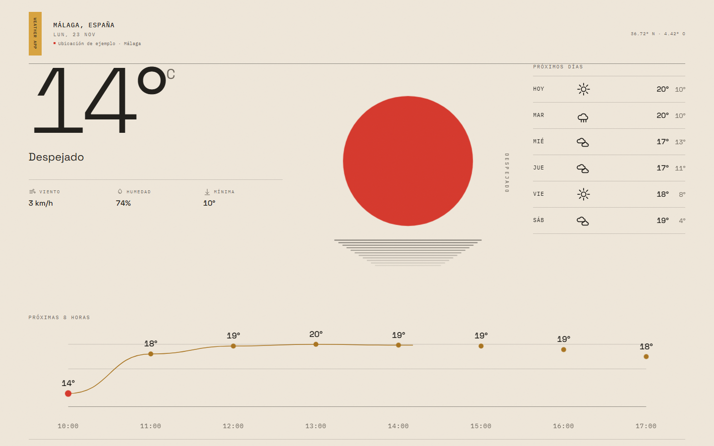
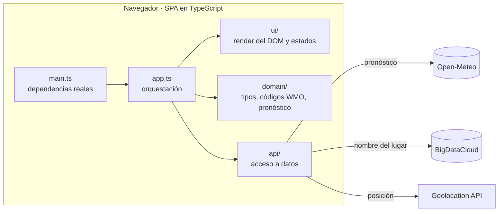

<div align="center">


# WeatherApp

**El clima, leído como una página de revista.**

Dashboard meteorológico con estética editorial suizo-japonesa: papel cálido, tinta carbón, acentos coral y ocre, ilustraciones geométricas planas y un tema nocturno que sigue al amanecer y al ocaso reales del lugar.


[Especificación de diseño](docs/superpowers/specs/2026-10-28-weather-app-refactor-design.md) · [Plan de implementación](docs/superpowers/plans/2026-10-28-weather-app-refactor.md)



</div>

---

## Índice

- [Descripción](#descripción)
- [Funcionalidades](#funcionalidades)
- [Arquitectura](#arquitectura)
- [Puesta en marcha](#puesta-en-marcha)
- [Scripts](#scripts)
- [Calidad y tests](#calidad-y-tests)
- [Datos y fuentes](#datos-y-fuentes)
- [Despliegue](#despliegue)
- [Estructura del proyecto](#estructura-del-proyecto)
- [Contribuir](#contribuir)

## Descripción

WeatherApp es una SPA en TypeScript que muestra el tiempo de la ubicación del usuario en una sola pantalla. No tiene backend ni cuentas: los datos llegan de APIs públicas sin clave y toda la lógica se ejecuta en el navegador.

La interfaz está en **español** y se pensó primero para escritorio y tablet, con un apilado responsive para pantallas más pequeñas.

## Funcionalidades

| Área                  | Qué ofrece                                                                                                                                                  |
| --------------------- | ----------------------------------------------------------------------------------------------------------------------------------------------------------- |
| **Clima actual**      | Temperatura grande, descripción del estado del cielo y tres métricas: viento, humedad y mínima del día.                                                    |
| **Pronóstico**        | Seis días con icono, máxima y mínima, a partir de Open-Meteo y con la zona horaria del lugar.                                                              |
| **Próximas 8 horas**  | Curva de temperatura con cada hora etiquetada y eje de tiempo, pensada para ver de un vistazo la tendencia del día.                                       |
| **Tema nocturno**    | Cambia de paleta según el amanecer y el ocaso reales de la ubicación. Sin datos solares de ese día, usa de 20:00 a 08:00 como respaldo.                    |
| **Ubicación**         | Usa la geolocalización del navegador. Si no responde en 8 segundos o se deniega el permiso, muestra Málaga como ejemplo con un aviso visible.              |
| **Actualización**     | Botón manual que vuelve a consultar el pronóstico. Si falla, conserva los datos en pantalla y ofrece reintentar.                                          |
| **Nombre del lugar**  | Si la geocodificación inversa falla, el clima sigue visible y el encabezado muestra «Tu ubicación».                                                        |

## Arquitectura



- **`app.ts` recibe sus dependencias** (geolocalización, clima, geocodificación) por parámetro. `main.ts` las conecta con las implementaciones reales, así la orquestación se prueba sin red.
- **`domain/` no toca el DOM ni la red.** Ahí viven los tipos, la traducción de los códigos WMO a estados visuales, el formato y la selección del pronóstico (incluido el cálculo de día o noche).
- **`ui/` solo pinta.** Cada componente (clima actual, pronóstico diario, curva horaria, icono de la ilustración, aviso de estado) recibe datos ya preparados.
- **`styles/` usa tokens.** Los colores y tipografías están en `tokens.css`; el tema nocturno invierte esos tokens en lugar de duplicar estilos.

## Puesta en marcha

### Requisitos

- Node.js 22 o superior
- [pnpm](https://pnpm.io/) como gestor de paquetes

WeatherApp no necesita claves de API ni variables de entorno.

### Instalación

```bash
git clone <url-del-repositorio> WeatherApp
cd WeatherApp
pnpm install
pnpm dev   # http://localhost:5173
```

## Scripts

| Comando            | Descripción                                                             |
| ------------------ | ----------------------------------------------------------------------- |
| `pnpm dev`         | Servidor de desarrollo de Vite en `localhost:5173`.                     |
| `pnpm run build`   | Comprobación de tipos con `tsc --noEmit` y build de producción en `dist/`. |
| `pnpm run preview` | Sirve el build de producción para revisarlo en local.                   |
| `pnpm run lint`    | ESLint con `--max-warnings 0`.                                          |
| `pnpm run test`    | Suite de tests con Vitest.                                              |
| `pnpm run check`   | Lint, build y tests en una sola orden. Úsala antes de abrir un cambio.   |

## Calidad y tests

- **Tests unitarios con Vitest** sobre dominio, API, UI y la orquestación de la app (16 ficheros, 87 pruebas). Incluyen, por ejemplo, la selección del pronóstico y el cálculo de día y noche.
- **ESLint con typescript-eslint:** `pnpm run lint` falla ante cualquier warning.
- **Fixtures compartidos** en `src/test/fixtures.ts` para no repetir respuestas de Open-Meteo en cada prueba.

## Datos y fuentes

- **[Open-Meteo](https://open-meteo.com/)** para el clima actual, las horas siguientes y los siete días de pronóstico (se muestran seis). Pide la zona horaria del lugar con `timezone=auto`, de modo que las horas y el amanecer/ocaso son locales.
- **[BigDataCloud](https://www.bigdatacloud.com/)** para convertir las coordenadas en un nombre de ubicación, sin API key.
- **Geolocalización del navegador** para la posición inicial. Sin permiso o sin respuesta en 8 segundos, se usa Málaga y se avisa al usuario.

La actualización manual solo vuelve a consultar Open-Meteo: conserva lo que hay en pantalla y, si falla, muestra un aviso con reintento.

## Despliegue

El build es estático. `vite.config.ts` fija `base: './'`, así que `dist/` puede servirse desde la raíz de cualquier dominio o desde una subcarpeta sin reconfigurar nada.

```bash
pnpm run build     # genera dist/
pnpm run preview   # revisa el resultado en local
```

## Estructura del proyecto

```text
WeatherApp/
├── src/
│   ├── api/           # Open-Meteo, geocodificación inversa y geolocalización
│   ├── domain/        # tipos, códigos WMO, pronóstico, formato y luz diurna
│   ├── ui/            # render del DOM y estados (clima, pronóstico, curva, avisos)
│   ├── styles/        # tokens y CSS por componente
│   ├── utils/         # helpers del DOM
│   ├── test/          # fixtures compartidos
│   ├── app.ts         # orquestación con dependencias inyectables
│   └── main.ts        # entrada: dependencias reales y arranque
├── public/            # favicon y recursos estáticos
├── docs/
│   ├── img/           # capturas para este README
│   └── superpowers/   # especificaciones y planes de implementación
├── index.html
└── vite.config.ts
```

## Documentación

- [Especificación de diseño](docs/superpowers/specs/2026-10-28-weather-app-refactor-design.md) — refactor de la app y decisiones de arquitectura.
- [Especificación de ajustes visuales](docs/superpowers/specs/2026-10-28-weather-app-refactor-visual-fixes-design.md) — correcciones de diseño y tema nocturno.
- [Plan de implementación](docs/superpowers/plans/2026-10-28-weather-app-refactor.md) — pasos seguidos para el refactor.

## Contribuir

1. Crea una rama desde `dev` (`feat/...`, `fix/...`).
2. Mantén la separación por capas: lo que decide datos o reglas va en `domain/`, no en `ui/`.
3. Usa [Conventional Commits](https://www.conventionalcommits.org/) con ámbito, por ejemplo `fix(ui): ...` o `feat(app): ...`.
4. Ejecuta `pnpm run check` antes de abrir la pull request.

<div align="center">

Si el proyecto te resulta útil, deja una ⭐ en el repositorio.

</div>
