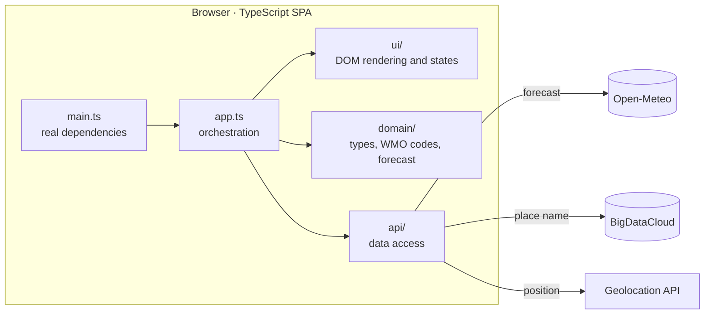

<div align="center">


# WeatherApp

**The weather, read like a magazine page.**

A weather dashboard with a Swiss-Japanese editorial look: warm paper, charcoal ink, coral and ochre accents, flat geometric illustrations and a night theme that follows the real sunrise and sunset of the place.


[Design spec](docs/superpowers/specs/2026-10-28-weather-app-refactor-design.md) · [Implementation plan](docs/superpowers/plans/2026-10-28-weather-app-refactor.md)


</div>

---

## Table of contents

- [Overview](#overview)
- [Features](#features)
- [Architecture](#architecture)
- [Getting started](#getting-started)
- [Scripts](#scripts)
- [Quality and tests](#quality-and-tests)
- [Data and sources](#data-and-sources)
- [Deployment](#deployment)
- [Project structure](#project-structure)
- [Documentation](#documentation)
- [Contributing](#contributing)

## Overview

WeatherApp is a TypeScript SPA that shows the weather for the user's location on a single screen. It has no backend and no accounts: data comes from public APIs that need no key, and all the logic runs in the browser.

The interface is in **Spanish**. It was designed desktop and tablet first, with a responsive stacked layout for smaller screens.

## Features

| Area                  | What it offers                                                                                                                                              |
| --------------------- | ----------------------------------------------------------------------------------------------------------------------------------------------------------- |
| **Current weather**   | Large temperature, a description of the sky and three metrics: wind, humidity and the day's low.                                                           |
| **Forecast**          | Six days with icon, high and low, from Open-Meteo and in the place's own time zone.                                                                        |
| **Next 8 hours**      | Temperature curve with every hour labelled and a time axis, built to show the day's trend at a glance.                                                     |
| **Night theme**       | Switches palette using the real sunrise and sunset of the location. With no solar data for that day, it falls back to 20:00–08:00.                         |
| **Location**          | Uses the browser's geolocation. If it does not answer within 8 seconds or permission is denied, it shows Málaga as an example with a visible notice.        |
| **Refresh**           | Manual button that queries the forecast again. If it fails, it keeps the data on screen and offers a retry.                                                |
| **Place name**        | If reverse geocoding fails, the weather stays visible and the header shows «Tu ubicación» ("Your location").                                               |

## Architecture



- **`app.ts` receives its dependencies** (geolocation, weather, geocoding) as parameters. `main.ts` wires them to the real implementations, so the orchestration can be tested without a network.
- **`domain/` never touches the DOM or the network.** It holds the types, the translation of WMO codes into visual states, formatting and forecast selection (including the day/night calculation).
- **`ui/` only paints.** Each component (current weather, daily forecast, hourly curve, illustration icon, status notice) receives data that is already prepared.
- **`styles/` uses tokens.** Colors and typography live in `tokens.css`; the night theme inverts those tokens instead of duplicating styles.

## Getting started

### Requirements

- Node.js 22 or later
- [pnpm](https://pnpm.io/) as the package manager

WeatherApp needs no API keys or environment variables.

### Installation

```bash
git clone <repository-url> WeatherApp
cd WeatherApp
pnpm install
pnpm dev   # http://localhost:5173
```

## Scripts

| Command            | Description                                                              |
| ------------------ | ------------------------------------------------------------------------ |
| `pnpm dev`         | Vite development server on `localhost:5173`.                             |
| `pnpm run build`   | Type check with `tsc --noEmit` and production build into `dist/`.        |
| `pnpm run preview` | Serves the production build so you can review it locally.                |
| `pnpm run lint`    | ESLint with `--max-warnings 0`.                                          |
| `pnpm run test`    | Vitest test suite.                                                       |
| `pnpm run check`   | Lint, build and tests in a single command. Run it before opening a change. |

## Quality and tests

- **Unit tests with Vitest** covering the domain, the API layer, the UI and the app orchestration (16 files, 87 tests). They include, for example, forecast selection and the day/night calculation.
- **ESLint with typescript-eslint:** `pnpm run lint` fails on any warning.
- **CI:** a GitHub Actions workflow runs `pnpm run check` on every pull request to `main` or `dev` and on every push to `main`.
- **Shared fixtures** in `src/test/fixtures.ts` so Open-Meteo responses are not repeated in every test.

## Data and sources

- **[Open-Meteo](https://open-meteo.com/)** for the current weather, the next hours and the seven-day forecast (six are shown). It asks for the place's time zone with `timezone=auto`, so hours and sunrise/sunset are local.
- **[BigDataCloud](https://www.bigdatacloud.com/)** to turn coordinates into a place name, with no API key.
- **Browser geolocation** for the initial position. Without permission, or with no answer within 8 seconds, it uses Málaga and notifies the user.

The manual refresh only queries Open-Meteo again: it keeps what is on screen and, if it fails, shows a notice with a retry option.

## Deployment

The build is static. `vite.config.ts` sets `base: './'`, so `dist/` can be served from the root of any domain or from a subfolder without further configuration.

```bash
pnpm run build     # generates dist/
pnpm run preview   # review the result locally
```

## Project structure

```text
WeatherApp/
├── src/
│   ├── api/           # Open-Meteo, reverse geocoding and geolocation
│   ├── domain/        # types, WMO codes, forecast, formatting and daylight
│   ├── ui/            # DOM rendering and states (weather, forecast, curve, notices)
│   ├── styles/        # tokens and per-component CSS
│   ├── utils/         # DOM helpers
│   ├── test/          # shared fixtures
│   ├── app.ts         # orchestration with injectable dependencies
│   └── main.ts        # entry point: real dependencies and startup
├── public/            # favicon and static assets
├── docs/
│   ├── img/           # screenshots for this README
│   └── superpowers/   # specs and implementation plans
├── index.html
└── vite.config.ts
```

## Documentation

The linked documents are written in Spanish.

- [Design spec](docs/superpowers/specs/2026-10-28-weather-app-refactor-design.md) — app refactor and architecture decisions.
- [Visual fixes spec](docs/superpowers/specs/2026-10-28-weather-app-refactor-visual-fixes-design.md) — design corrections and the night theme.
- [Implementation plan](docs/superpowers/plans/2026-10-28-weather-app-refactor.md) — steps followed for the refactor.

## Contributing

1. Create a branch from `dev` (`feat/...`, `fix/...`).
2. Keep the layer separation: anything that decides data or rules goes in `domain/`, not in `ui/`.
3. Use [Conventional Commits](https://www.conventionalcommits.org/) with a scope, for example `fix(ui): ...` or `feat(app): ...`. Write commits and pull requests in English.
4. Run `pnpm run check` before opening the pull request.

<div align="center">

If you find the project useful, leave a ⭐ on the repository.

</div>
